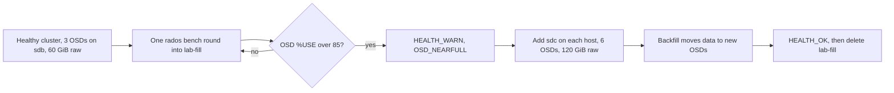

# Fill the cluster, then add the reserve disks

This exercise shows what Ceph does when it runs low on space, and how adding disks fixes it. You fill a test pool until Ceph warns that the OSDs are nearly full. Then you add the empty 20 GiB reserve disk on each storage VM as a second OSD and watch Ceph spread the data out.

Status: planned. Not run on the Vagrant lab yet. Record what you observe in a new finding in `docs/podman/findings/`, and update the [reserve disk](../../../../knowledge/okf/storage/reserve-disk.md) knowledge page.

Run Ceph commands on **node-01** unless a step says otherwise. Start from a healthy cluster built with the [deployment guide](deploy-vm-cluster.md).

## The steps at a glance



## How much space there is

| Stage | Raw space | Usable with three copies |
| --- | --- | --- |
| Start: one 20 GiB OSD per host | 3 × 20 = 60 GiB | about 20 GiB |
| After adding the reserve disks | 6 × 20 = 120 GiB | about 40 GiB |

Ceph acts on three fullness ratios of each OSD:

| Ratio | Default | What happens |
| --- | --- | --- |
| nearfull | 0.85 | `HEALTH_WARN`, writes still work |
| backfillfull | 0.90 | Ceph stops moving data onto that OSD |
| full | 0.95 | `HEALTH_ERR`, **writes stop** |

This exercise stops at nearfull. Never push the cluster to full: getting out of it is harder than getting in. See the [Ceph monitoring docs](https://docs.ceph.com/en/tentacle/rados/operations/monitoring/#storage-capacity).

Check the ratios:

```sh
sudo cephadm shell -- ceph osd dump | grep ratio
```

Expect `full_ratio 0.95`, `backfillfull_ratio 0.9` and `nearfull_ratio 0.85`.

## Create a fill pool

Create a separate pool, so the test data never mixes with real data:

```sh
sudo cephadm shell -- ceph osd pool create lab-fill 32
```

```sh
sudo cephadm shell -- ceph osd pool application enable lab-fill rados
```

Record the starting state:

```sh
sudo cephadm shell -- ceph df
```

```sh
sudo cephadm shell -- ceph osd df
```

`ceph df` shows about 60 GiB raw. `MAX AVAIL` for `lab-fill` is what one copy may still use, a little under 20 GiB. `ceph osd df` shows `%USE` per OSD.

## Fill it in steps

`rados bench` is Ceph's built-in write test. It writes 4 MiB objects into a pool for a given number of seconds. `--no-cleanup` keeps the objects, so each round adds to the pool. Each round is one command, and you check the usage after it.

On node-01, write for 30 seconds:

```sh
sudo cephadm shell -- rados bench -p lab-fill 30 write --no-cleanup
```

At the end it prints a summary. `Total writes made` times 4 MiB is the data written in this round; the raw space used is three times that.

Check the usage:

```sh
sudo cephadm shell -- ceph osd df
```

```sh
sudo cephadm shell -- ceph health
```

Note how many percentage points of `%USE` the round added, and record it. Write speed depends on your computer's disk, so one round can add anything from a few points to over 20.

Run the same `rados bench` command again, then check again. If one round added more than 10 points, use 10 seconds instead of 30. When `%USE` passes about 75, use 5 seconds:

```sh
sudo cephadm shell -- rados bench -p lab-fill 5 write --no-cleanup
```

Stop as soon as `ceph health` shows `HEALTH_WARN`. Then look at the details:

```sh
sudo cephadm shell -- ceph health detail
```

Expect `OSD_NEARFULL` for the three OSDs and `POOL_NEARFULL` for the pools. Writes still work at this point. If `%USE` ever passes 90, stop writing at once and go straight to the next section.

## If the reserve disks are already OSDs

The dashboard's **Add storage** wizard, cephadm's `--all-available-devices`, or any OSD spec that matches all spinning disks takes `/dev/sdc` too. On 2026-11-08 the wizard did exactly that. Check on **node-01**:

```sh
sudo cephadm shell -- ceph orch ls osd --export
```

The only OSD service should be `osd.data-disks` with `paths: - /dev/sdb`. Any other OSD service, such as `osd.cost_capacity` or `osd.all-available-devices`, claims every free disk.

To give the reserve disks back, first stop that service from claiming disks again, using its name from the output:

```sh
sudo cephadm shell -- ceph orch set-unmanaged osd.cost_capacity
```

Find which OSDs sit on `sdc`. For each OSD number above 2:

```sh
sudo cephadm shell -- ceph osd metadata 3
```

Look for `"devices": "sdc"` and the `"hostname"`. Only continue for OSDs on `sdc`. Then drain them, remove them and wipe their disks. **This erases those `sdc` disks.** Ceph first moves their data back to the other OSDs:

```sh
sudo cephadm shell -- ceph orch osd rm 3 4 5 --zap
```

Watch until the list is empty:

```sh
sudo cephadm shell -- ceph orch osd rm status
```

Expect `No OSD remove/replace operations reported` at the end. Remove the extra service:

```sh
sudo cephadm shell -- ceph orch rm osd.cost_capacity
```

Check that `/dev/sdc` is `Available Yes` on all three hosts and the cluster is healthy:

```sh
sudo cephadm shell -- ceph orch device ls --refresh
```

```sh
sudo cephadm shell -- ceph -s
```

## Find the reserve disks

On **each storage VM**, confirm the reserve disk is still empty:

```sh
lsblk -o NAME,SIZE,TYPE,FSTYPE,MOUNTPOINTS /dev/sdc
```

```sh
sudo wipefs /dev/sdc
```

Expect a 20G disk with no filesystem, and no output from `wipefs`. Confirm the port: `ls -l /dev/disk/by-path/ | grep 0:0:2:0` should point to `sdc`.

On **node-01**, confirm cephadm sees it as available on all three hosts:

```sh
sudo cephadm shell -- ceph orch device ls
```

Expect `/dev/sdc` with `Available` `Yes` on node-01, node-02 and node-03. If a host shows anything else, stop and find out why.

## Add the reserve disks

Change the OSD layout to include the reserve disk. On **node-01**, edit `/home/vagrant/cluster-spec.yaml` and add one line to the end of the OSD section:

```yaml
spec:
  objectstore: bluestore
  data_devices:
    paths:
      - /dev/sdb
      - /dev/sdc
```

Preview the change first. `--dry-run` shows what cephadm would create without creating it:

```sh
sudo cephadm shell --mount /home/vagrant/cluster-spec.yaml:/spec.yaml -- ceph orch apply -i /spec.yaml --dry-run
```

Run the same command again after a minute if it says the preview is not ready. Expect three new OSDs, one on `/dev/sdc` of each host, and nothing else. Apply it:

```sh
sudo cephadm shell --mount /home/vagrant/cluster-spec.yaml:/spec.yaml -- ceph orch apply -i /spec.yaml
```

Watch the new OSDs appear:

```sh
sudo cephadm shell -- ceph osd tree
```

After a few minutes, expect six OSDs, two under each host, all `up`.

## Watch the data move

Ceph now moves part of the data onto the new OSDs. This is called backfill. Watch it:

```sh
sudo cephadm shell -- ceph -s
```

You see placement groups in states such as `backfilling` and `remapped`, and a recovery rate. With a few GiB per OSD this takes some minutes. Check again until all placement groups are `active+clean`.

Compare the space:

```sh
sudo cephadm shell -- ceph osd df
```

```sh
sudo cephadm shell -- ceph df
```

Expect about 120 GiB raw, `%USE` around half of what it was, and the nearfull warnings gone:

```sh
sudo cephadm shell -- ceph health
```

Expect `HEALTH_OK`.

## Check memory

Each storage VM now runs two OSDs. On **each storage VM**:

```sh
free -m
```

On **node-01**, see the memory each daemon uses:

```sh
sudo cephadm shell -- ceph orch ps
```

If a VM has less than about 500 MiB available, lower the OSD target from 1.5 GiB to 1 GiB:

```sh
sudo cephadm shell -- ceph config set osd osd_memory_target 1073741824
```

## Clean up the fill data

Pool deletion is off by default. Turn it on only for this step, delete the test pool, and turn it off again:

```sh
sudo cephadm shell -- ceph config set mon mon_allow_pool_delete true
```

```sh
sudo cephadm shell -- ceph osd pool rm lab-fill lab-fill --yes-i-really-really-mean-it
```

```sh
sudo cephadm shell -- ceph config set mon mon_allow_pool_delete false
```

Check that the space came back:

```sh
sudo cephadm shell -- ceph df
```

Keep `/home/vagrant/cluster-spec.yaml` with both disk paths. If you re-apply the original file with only `/dev/sdb`, cephadm stops creating new OSDs on `/dev/sdc` but does not remove the existing ones.

## What this shows

- Ceph warns early, at 85 percent, and stops writes at 95 percent of the fullest OSD, not of the average.
- Adding disks gives more space only after backfill has moved data onto them.
- With three copies, 60 GiB of new raw space gives about 20 GiB of usable space.

See [HA and capacity](../explanation/ha-and-capacity.md).
