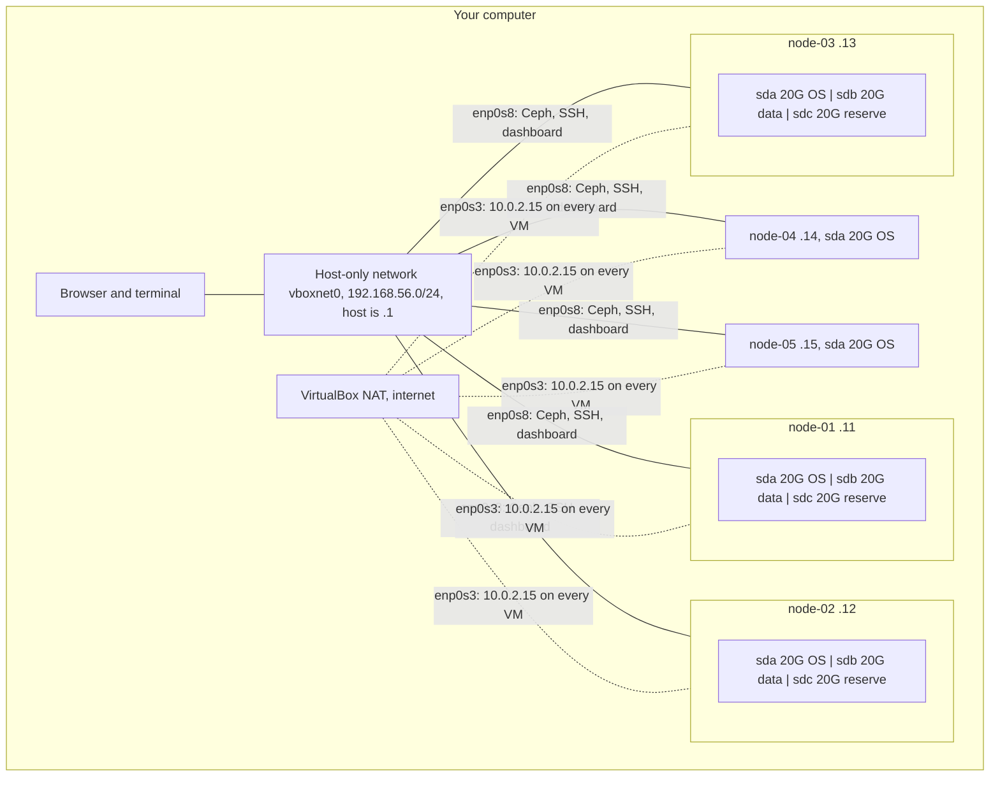

# Create the lab VMs with Vagrant

This guide creates the lab VMs on your own computer with Vagrant and VirtualBox. It does not install Ceph. When it is done, continue with the [preflight checks](vm-preflight.md).

Run every command in this guide on **your computer** (the host), from the `vm/vagrant/podman/` folder, unless a step says otherwise.

## What you get

The [Vagrantfile](../../../../vm/vagrant/podman/Vagrantfile) defines five VMs. Each one has 2 CPUs, 6 GB RAM and a 20 GB OS disk.

| VM | Address | Role | Extra disks | Started by `vagrant up` |
| --- | --- | --- | --- | --- |
| node-01 | 192.168.56.11 | Ceph storage, first admin host | 20 GB data (`/dev/sdb`), 20 GB reserve (`/dev/sdc`) | yes |
| node-02 | 192.168.56.12 | Ceph storage, second admin host, monitoring, dashboard gateway | same | yes |
| node-03 | 192.168.56.13 | Ceph storage | same | yes |
| node-04 | 192.168.56.14 | Normal VM that uses Ceph block storage | none | no, start it by name |
| node-05 | 192.168.56.15 | Single-node k3s that uses Ceph through CSI | none | no, start it by name |

The three storage VMs use their data disk as the first Ceph OSD. The reserve disk stays empty. Later you fill the cluster until Ceph warns about low space, then add the reserve disks as new OSDs. See [add the reserve disks](add-reserve-disks.md).

All five VMs together use 10 CPUs and 30 GB RAM. Disk files are thin, so they grow only as data is written.

## Requirements

- VirtualBox 7.x and Vagrant 2.4 or newer. This lab was tested with VirtualBox 7.2.22 and Vagrant 2.4.9.
- About 12 CPU threads and 40 GB RAM on the host to run all five VMs, or about 6 CPU threads and 20 GB RAM for only the three storage VMs.
- About 50 GB free disk space on the host for the storage VMs at first. Filling the cluster and adding the client VMs needs more.
- Internet access for the box, packages and container images.

Check the tools:

```sh
vagrant --version
```

```sh
VBoxManage --version
```

Each prints a version number. If a command is not found, install that tool first.

## Network

Each VM gets two network cards:

| Card | Guest interface | Address | Used for |
| --- | --- | --- | --- |
| 1, NAT | `enp0s3` | `10.0.2.15` on **every** VM | Internet access and `vagrant ssh` |
| 2, host-only | `enp0s8` | 192.168.56.11 to 15 | Ceph traffic, SSH between VMs, the dashboard |



The solid lines are the host-only network that Ceph uses. The dotted lines are the NAT card, used only for internet access and `vagrant ssh`. The NAT address is the same on every VM, so Ceph must never use it. Every Ceph command in these guides uses a 192.168.56.x address.

VirtualBox allows host-only addresses in 192.168.56.0/21 by default. If you change the addresses in the Vagrantfile to another range, allow it in `/etc/vbox/networks.conf` first.

## Create the storage VMs

Go to the Vagrant folder in your copy of this repository:

```sh
cd vm/vagrant/podman
```

Check the Vagrantfile:

```sh
vagrant validate
```

Expect `Vagrantfile validated successfully.`

Create and boot node-01 to node-03:

```sh
vagrant up
```

The first run downloads the `cloud-image/ubuntu-26.04` box, which takes a few minutes. For each VM, expect these lines:

```text
Disk 'node-01-os' needs to be resized. Resizing disk...
Disk 'node-01-data' not found in guest. Creating and attaching disk to guest...
Disk 'node-01-reserve' not found in guest. Creating and attaching disk to guest...
...
Machine booted and ready!
```

A warning that the guest additions do not match VirtualBox is harmless here, because this lab does not use shared folders.

Check the result:

```sh
vagrant status
```

Expect node-01, node-02 and node-03 `running`, and node-04 and node-05 `not created`.

## Create the client VMs when you need them

The client VMs are needed only after Ceph is running. Start them by name:

```sh
vagrant up node-04
```

```sh
vagrant up node-05
```

## Connect to a VM

From the `vm/vagrant/podman/` folder:

```sh
vagrant ssh node-01
```

You are now the `vagrant` user on node-01, which has passwordless sudo. Type `exit` to come back to your computer.

## Check one VM

On **node-01**, check CPUs and memory:

```sh
nproc
```

```sh
free -m
```

Expect `2` and a total of about 5900 MiB.

Check the root filesystem. The box ships with a 10 GB disk, Vagrant grows it to 20 GB and the cloud image grows the filesystem on first boot:

```sh
df -h /
```

Expect a size of about 19G on `/dev/sda1`, with about 17G available.

List the disks:

```sh
lsblk -o NAME,SIZE,TYPE,FSTYPE,MOUNTPOINTS
```

Expect `sda` with the root filesystem, and `sdb` and `sdc` with no filesystem and no mount point. All three disks are 20G, so tell them apart by contents and port, never by size.

Check the addresses:

```sh
ip -4 -brief address
```

Expect `enp0s8` with `192.168.56.11/24` and `enp0s3` with `10.0.2.15/24`.

Repeat on node-02 and node-03. The [preflight](vm-preflight.md) checks the rest.

## Stop, start and remove

From the `vm/vagrant/podman/` folder on your computer.

Shut down all running VMs. Disks and data stay:

```sh
vagrant halt
```

Start them again:

```sh
vagrant up
```

Apply a changed Vagrantfile, such as more memory, by rebooting the VMs:

```sh
vagrant reload
```

**Do not remove a disk from the Vagrantfile while its VM exists.** On the next `vagrant reload`, Vagrant detaches and deletes disks that are no longer listed, together with their Ceph data.

Delete all VMs and all their disks, including every Ceph OSD. Only do this when you want to start over:

```sh
vagrant destroy
```

Vagrant asks for confirmation for each VM. Ceph data cannot be recovered afterwards.
