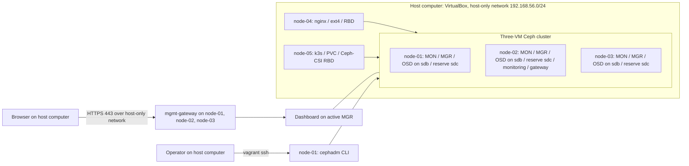

# VM architecture overview

The VM track runs five VirtualBox VMs created by Vagrant on one host computer. See [ADR 0009](../adr/0009-vagrant-virtualbox-lab.md).

Status: VMs created and checked on 2026-11-08; Ceph deployment planned. See the [VM finding](../../knowledge/okf/findings/2026-11-08-vagrant-vms.md).

## Goals and constraints

Deploy Ceph on three VMs, use their data disks as OSDs, and manage the cluster through the dashboard. Install by hand first, then automate with Ansible. Show low-space behavior and expansion with a reserve disk per host. Client storage is a separate extension that does not add storage hosts. Everything must fit on a host with 12 CPU threads and 40 GB RAM.

## Context and building blocks

Each VM has 2 vCPUs, 6 GB RAM and a 20 GB OS disk. Each storage VM also has a 20 GB data disk and a 20 GB reserve disk. The active MGR can be any of the three storage hosts. MDS and RGW remain deferred.

## Configuration and deployment

The [Vagrantfile](../../vagrant/Vagrantfile) defines VMs, disks and addresses. [Observed inventory](../../inventory/vagrant.json) records what the VMs reported. [Version configuration](../../config/versions.json) records selected artifacts and image digests. The [cluster spec](../../config/cluster-spec.example.yaml) and [monitoring spec](../../config/monitoring-spec.yaml) declare placement through host labels. No credentials are stored in any of these files.

Stages: Vagrant creates VMs; Ceph is installed by hand from the [deployment guide](../diataxis/how-to/deploy-vm-cluster.md); Ansible automation follows once the manual steps are verified.

## Dashboard runtime

All browser access goes through a cephadm `mgmt-gateway` on HTTPS port 443. One runs on each storage VM, and each routes to the active MGR. A manager failover therefore does not change the URLs `https://192.168.56.11/`, `.12/` or `.13/`; losing one VM leaves the other two addresses. Dashboard POST requests can still reach a standby and fail with 503, see [ADR 0011](../adr/0011-gateway-template-override.md). Prometheus, Grafana and Alertmanager run behind the same gateway. See [ADR 0010](../adr/0010-production-aligned-baseline.md).

## Storage runtime views

Low space and expansion: the fill pool reaches the nearfull ratio of the three first OSDs; three reserve OSDs are added on `/dev/sdc`; backfill moves placement groups until the cluster is clean. See [add the reserve disks](../diataxis/how-to/add-reserve-disks.md).

Native RBD: host nginx, then the /srv/cephdata ext4 filesystem, then a mapping of native-rbd/native-data, then Ceph OSDs. MONs provide cluster maps and authentication; they do not proxy the data stream.

Kubernetes: a PVC makes the CSI provisioner create an RBD image, the CSI node plugin maps and mounts it, and the pod writes through the volume to Ceph OSDs.

CephFS: the client obtains namespace metadata through MDS and accesses file data through OSDs.

Failure: one storage VM stops (`vagrant halt`), the remaining MONs keep quorum, affected PGs degrade, eligible I/O continues under min_size, the VM returns, recovery completes, and data and health are verified.

## Cross-cutting concerns and risks

Use least-privilege credentials, pinned versions, explicit disk targeting, sanitized diagnostics and documented recovery. Primary risks: one host computer for every VM, 6 GB RAM per storage VM with two OSDs, small disks filling quickly, and client kernel compatibility with current Ceph keys. [ADR 0010](../adr/0010-production-aligned-baseline.md) lists every gap to production.

Operational criteria live in the [validation matrix](../diataxis/reference/vm-validation.md). Decisions live in [ADRs](../adr/README.md); open questions live in the [knowledge register](../../knowledge/okf/README.md).
