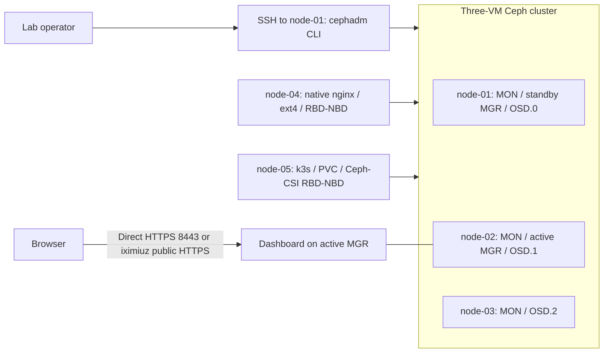

# VM architecture overview

The VM track supports any suitable Linux VM provider and routed network. The diagram below shows the existing iximiuz deployment as a concrete example. Standard SSH is the default access method; labctl is optional. See [ADR 0005](../adr/0005-provider-independent-guides.md).

Status: three-node cephadm baseline deployed; native RBD and k3s/CSI consumers are deployed. See [deployment evidence](../../knowledge/okf/findings/2026-11-05-vm-bootstrap.md).

## Goals and constraints

Deploy Ceph on three Linux VMs, consume their second disks as OSDs, and manage the cluster through the dashboard. Support a reachable LAN or routed network on VirtualBox, cloud VMs or iximiuz Labs. The existing iximiuz network is already configured and is left unchanged. Client storage integration is implemented as a separate extension without expanding the three-host storage cluster.

## Context and building blocks

Each host has a separate OS disk and approximately 80 GiB data disk. The active MGR shown is the observed role, not a permanent assignment. The UI uses the same three hosts, not a separate VM. The three-host core is unchanged. Native node-04 and single-node k3s on node-05 now consume separate RBD images. MDS and RGW remain deferred.

## Configuration and deployment

[Observed inventory](../../inventory/iximiuz.json) records hosts, playground access identifiers, addresses, resources and disks. [Version configuration](../../config/versions.json) records selected artifacts and the Ceph image digest. [ADR 0004](../adr/0004-vm-deployment-baseline.md) explains those choices. No credentials are stored in either file. Manager active/standby roles shown above reflect the verified snapshot and can change during failover.

## Dashboard runtime

For direct VM access, the active MGR serves authenticated HTTPS on 8443. Other reachable VM platforms use its VM address directly. In the tested iximiuz environment, the user approved HTTP on 18080 behind `labctl expose port` with public HTTPS because backend TLS negotiation failed. TLS and the admin account are cluster configuration, while public exposure belongs to the VM provider. Failover may change the active address and exposure target. See [ADR 0007](../adr/0007-vm-owned-docs-and-dashboard.md).

## Client runtime views

Native RBD: host nginx → /srv/cephdata ext4 filesystem → NBD mapping of native-rbd/native-data → Ceph OSDs. MONs provide cluster maps and authentication coordination; they do not proxy the application's data stream.

Kubernetes: PVC → CSI provisioner creates RBD image → CSI node plugin maps/mounts it → pod writes through the volume to Ceph OSDs. Pod recreation must reuse the PVC for the persistence test.

CephFS: client obtains namespace metadata through MDS and accesses file data through OSDs. Active/standby MDS placement is separate from MON quorum.

Failure: one storage host stops → remaining MONs retain quorum → affected PGs degrade → eligible I/O continues under min_size policy → host returns → recovery completes → data and health are verified.

## Cross-cutting concerns and risks

Use least-privilege credentials, pinned versions, explicit disk targeting, sanitized diagnostics and documented recovery. Capacity headroom, recovery memory pressure, hub dependency, ephemeral playground lifetime and client kernel compatibility are the primary initial risks. Performance and availability findings apply only to the measured environment.

The client pools share the same 240 GiB raw capacity: nominal 80 GiB before overhead with three replicas. Pool data quotas are 20 GiB native and 40 GiB k3s. See [ADR 0008](../adr/0008-rbd-clients-and-capacity-budget.md) and the [client finding](../../knowledge/okf/findings/2026-11-05-client-storage.md) for the NBD compatibility choice and observed HA test.

Operational criteria live in the [validation matrix](../diataxis/reference/vm-validation.md). Decisions live in [ADRs](../adr/README.md); unresolved details live in the [knowledge register](../../knowledge/okf/README.md).
