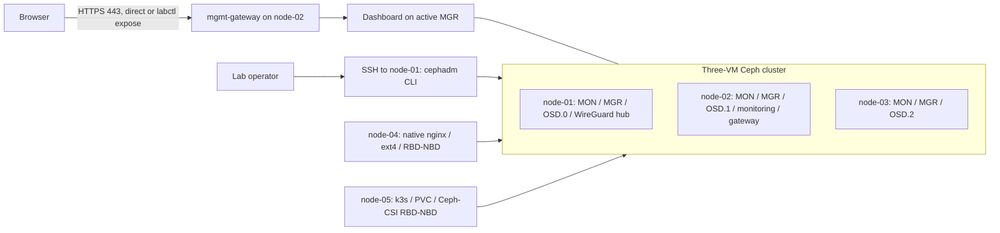

# VM architecture overview

The VM track supports any suitable Linux VM provider and routed network. The diagram below shows the existing iximiuz deployment as a concrete example. Standard SSH is the default access method; labctl is optional. See [ADR 0005](../adr/0005-provider-independent-guides.md).

Status: three-node cephadm cluster with monitoring and HTTPS gateway deployed; native RBD and k3s/CSI consumers are deployed. See [deployment evidence](../../knowledge/okf/findings/2026-11-05-production-baseline.md).

## Goals and constraints

Deploy Ceph on three Linux VMs, consume their second disks as OSDs, and manage the cluster through the dashboard. Support a reachable LAN or routed network on VirtualBox, cloud VMs or iximiuz Labs. The existing iximiuz network is already configured and is left unchanged. Client storage integration is implemented as a separate extension without expanding the three-host storage cluster.

## Context and building blocks

Each host has a separate OS disk and approximately 80 GiB data disk. The active MGR can be any of the three hosts. The UI uses the same three hosts, not a separate VM. The three-host core is unchanged. Native node-04 and single-node k3s on node-05 now consume separate RBD images. MDS and RGW remain deferred. The WireGuard hub role belongs to the iximiuz example only.

## Configuration and deployment

[Observed inventory](../../inventory/iximiuz.json) records hosts, playground access identifiers, addresses, resources and disks. [Version configuration](../../config/versions.json) records selected artifacts and the Ceph image digest. [ADR 0004](../adr/0004-vm-deployment-baseline.md) explains those choices. No credentials are stored in either file. The [cluster spec](../../config/cluster-spec.example.yaml) and [monitoring spec](../../config/monitoring-spec.yaml) declare placement through host labels.

## Dashboard runtime

All browser access goes through the cephadm `mgmt-gateway` on HTTPS port 443, which routes to the active MGR. A manager failover therefore does not change the URL; one 503 sample was observed during the test. Other VM platforms open the gateway host directly. iximiuz uses `labctl expose port <playground> 443 --https` without `--public`. Prometheus, Grafana and Alertmanager run behind the same gateway. See [ADR 0010](../adr/0010-production-aligned-baseline.md).

## Client runtime views

Native RBD: host nginx, then the /srv/cephdata ext4 filesystem, then an NBD mapping of native-rbd/native-data, then Ceph OSDs. MONs provide cluster maps and authentication coordination; they do not proxy the application's data stream.

Kubernetes: a PVC makes the CSI provisioner create an RBD image, the CSI node plugin maps and mounts it, and the pod writes through the volume to Ceph OSDs. Pod recreation must reuse the PVC for the persistence test.

CephFS: client obtains namespace metadata through MDS and accesses file data through OSDs. Active/standby MDS placement is separate from MON quorum.

Failure: one storage host stops, remaining MONs retain quorum, affected PGs degrade, eligible I/O continues under min_size policy, the host returns, recovery completes, and data and health are verified. In the iximiuz example, losing hub node-01 also interrupts traffic between the other hosts until it returns.

## Cross-cutting concerns and risks

Use least-privilege credentials, pinned versions, explicit disk targeting, sanitized diagnostics and documented recovery. Capacity headroom, recovery memory pressure, hub dependency, ephemeral playground lifetime and client kernel compatibility are the primary risks. [ADR 0010](../adr/0010-production-aligned-baseline.md) lists every remaining gap to production. Performance and availability findings apply only to the measured environment.

The client pools share the same 240 GiB raw capacity: nominal 80 GiB before overhead with three replicas. Pool data quotas are 20 GiB native and 40 GiB k3s. See [ADR 0008](../adr/0008-rbd-clients-and-capacity-budget.md) and the [baseline finding](../../knowledge/okf/findings/2026-11-05-production-baseline.md) for the NBD compatibility test and observed HA results.

Operational criteria live in the [validation matrix](../diataxis/reference/vm-validation.md). Decisions live in [ADRs](../adr/README.md); unresolved details live in the [knowledge register](../../knowledge/okf/README.md).
